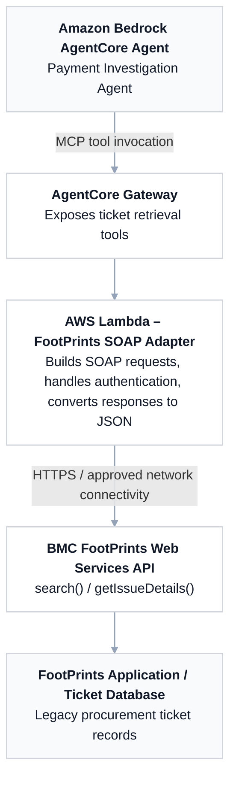

# AWS AgentCore – BMC FootPrints API Integration

**Purpose:** Enable the Payment Investigation Agent to retrieve procurement tickets from the legacy BMC FootPrints application through its SOAP Web Services API.

## Architecture diagram

## Component responsibilities

| Component | Responsibility |
|---|---|
| **Amazon Bedrock AgentCore Agent** | Payment Investigation Agent invokes a tool to search for or retrieve FootPrints tickets. |
| **AgentCore Gateway** | Exposes the read-only ticket retrieval tools to the agent over MCP. |
| **AWS Lambda – FootPrints SOAP Adapter** | Validates the tool request, creates the SOAP call, supplies authorized credentials, and normalizes XML responses into JSON. |
| **BMC FootPrints Web Services API** | Processes `search()` and `getIssueDetails()` calls. |
| **FootPrints Application / Ticket Database** | Stores the legacy procurement ticket records returned by the API. |

## Integration assumptions to validate

- The deployed FootPrints version supports and has enabled the documented SOAP Web Services API.
- The team confirms the actual endpoint URL, workspace IDs, service account permissions, and HTTPS/TLS setup.
- AWS-to-FootPrints connectivity and routing are approved for the deployment environments.
- The adapter uses approved read-only query templates; the agent does not issue unrestricted database queries.

**Diagram status:** Proposed target architecture, not evidence of a tested connection.

**Editable diagram:** Open `agentcore-footprints-integration.drawio` in [diagrams.net](https://app.diagrams.net/).
