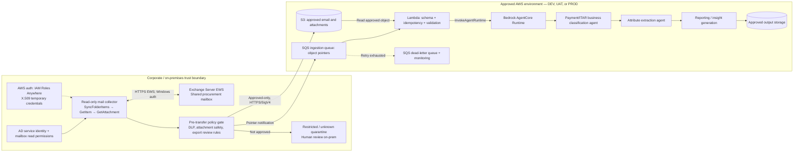

# On-Premises Exchange Shared-Mailbox Integration with Amazon Bedrock AgentCore

**Target architecture and implementation plan**  
**Use case:** Procurement/payment inquiry email ingestion, ITAR-aware routing, classification, extraction, and downstream reporting  
**Status:** Proposed design — requires Exchange, IAM, network, and export-control validation  
**Prepared:** 9 November 2026  
**Scope:** On-premises mailbox → approved AWS ingestion → AgentCore; **no SAP, Ariba, or FootPrints integration**.

## 1. Executive recommendation

**Recommended target:** deploy a small **read-only Exchange EWS collector inside the corporate network**, running under a dedicated, permissioned Active Directory (AD) service identity. It retrieves new messages through **Exchange Web Services (EWS) over HTTPS**, stages only data approved for transfer to AWS, and publishes object pointers/events into isolated AWS resources. An **AWS SQS-triggered Lambda** validates the event and invokes a **Bedrock AgentCore Runtime** email-classification/extraction workflow. The agent does **not** directly log in to Exchange and does **not** handle the Exchange service-account password.

The collector can run as a managed Windows service (or approved equivalent on-premises host). Use EWS `SyncFolderItems`, `GetItem`, and `GetAttachment`; keep a durable sync checkpoint and process items idempotently. **The path from corporate premises to AWS is outbound HTTPS** using short-lived AWS credentials via **IAM Roles Anywhere**, provided security approves certificate-based AWS federation. Amazon S3 carries approved message content/attachments; SQS carries only a small object reference and a non-sensitive correlation ID.

**Why this over “AgentCore directly calls Outlook”:** Outlook is a client, not an API. Exchange Server supplies EWS; AgentCore is an orchestration/runtime service, not a Windows mailbox synchronization engine. Locating the connector on-premises avoids needing AWS-initiated access through corporate firewalls and keeps Exchange authentication on the trusted network.

**Conditional alternative:** If a private AWS↔on-premises route is already approved, a VPC-attached AWS Lambda can query Exchange EWS directly over a VPN/Direct Connect path. Use the same EWS and event/checkpoint logic; the collector's placement, credential handling, and firewall direction change. See diagram page 2 and §9.

**Hard prerequisite:** Verify that the mailbox is genuinely an **Exchange shared mailbox or a permissioned mailbox folder**, not merely a distribution list, a Microsoft 365 Group, an Outlook PST file, or a public folder. `SyncFolderItems` is *not* supported for Microsoft 365 Group mailboxes or public folders. Do not assume Graph is available or necessary.

**Product lifecycle caveat:** Microsoft Exchange Server 2016/2019 reached end of support on **14 October 2025**. If this is a legacy deployment, confirm whether the organization has migrated to Exchange Server Subscription Edition (SE), has an ESU arrangement, or accepts the risk. **Exchange Online EWS retirement does not automatically mean EWS on an on-premises Exchange Server is unavailable.** See Microsoft references in §14.

## 2. Source-confirmed behavior vs assumptions

| Classification | Statement |
|---|---|
| **Confirmed — Microsoft documentation** | Exchange EWS supports `SyncFolderItems` for folder change detection, followed by `GetItem` for message properties and `GetAttachment` for binary attachments. |
| **Confirmed — Microsoft documentation** | Exchange supports folder-level/delegate access and scoped impersonation patterns; prefer access limited to the target mailbox/folder. EWS on-premises supports NTLM; actual Kerberos/Windows-integrated support and other authentication settings must be tested with the installed Exchange build. |
| **Confirmed — AWS documentation** | IAM Roles Anywhere can provide short-lived IAM credentials to an application hosted outside AWS using X.509 certificates. AgentCore Runtime accepts `InvokeAgentRuntime` from an authorized AWS caller. |
| **Design choice (not a confirmed deployment fact)** | Deploy the polling collector on a corporate-managed Windows host and send *approved* email objects to S3 plus an SQS notification. |
| **Unknown — validate** | Exact Exchange Server version, EWS endpoint/authentication, shared-mailbox permissions, network egress to AWS, certificate authority, expected message/attachment sizes, ITAR data boundary, and whether permitted AgentCore services/models exist in that boundary. |

## 3. Target architecture — recommended on-premises collector

The accompanying **editable Draw.io file**, page **“01 — Recommended Push”**, is the authoritative detailed architecture drawing.



### Responsibilities and data ownership

| Component | Responsibilities | Credentials / data boundary |
|---|---|---|
| **Exchange Server / mailbox** | Hosts actual procurement mail and folders. | Corporate AD, Exchange access policy. |
| **Dedicated service account** | Authenticates to EWS; read-only scope for named mailbox/folders. | Managed on premises; no mailbox password exposed to AgentCore. |
| **Collector** | Folder discovery, incremental polling, message/attachment retrieval, safe normalization, retries, checkpointing, deduplication. | On-premises Windows service with controlled credential and local operational state. |
| **Pre-transfer policy gate** | Apply business-approved DLP/export-control routing; malware scan; size/type limits; hold unknown/restricted data. | Runs **before** content crosses the authorized cloud boundary. |
| **S3** | Stores *approved* raw MIME/body/attachments as encrypted objects, with appropriate lifecycle policies. | Per-environment bucket, KMS, tight bucket access. |
| **SQS** | Decouples the collector from processing; messages contain object URIs and opaque IDs, not full message bodies. | Per-environment queue and DLQ. |
| **Lambda ingestion consumer** | Validate object/event schema and authorization, deduplicate, load approved content, and invoke AgentCore Runtime. | IAM execution role; no Exchange credentials. |
| **AgentCore Runtime** | Business classification (payment relevance), extraction, and reporting orchestration on *permitted* content. | Agent runtime and underlying model must be approved for the specific data class. |
| **Results / telemetry** | Store reports and traceable outcome/status; redact logs and enforce retention. | IAM/KMS/CloudWatch/CloudTrail according to data classification. |

**Important:** AgentCore Gateway is **not required** for unattended scheduled email ingestion. In this event-driven design, the Lambda consumer calls AgentCore Runtime through its `InvokeAgentRuntime` API. An **optional** Gateway target can expose a controlled `get_approved_email` tool via Lambda if an agent needs on-demand access to *already approved* stored messages. The Gateway should **never** expose arbitrary EWS mailbox operations or a general-purpose mailbox password to the LLM.

## 4. Service-account and EWS connection specification

### 4.1 What the Exchange team must confirm

1. **Mail architecture:** Exchange Server SE/2019/2016 (and exact build/CU), shared mailbox vs folder vs distribution group, mailbox primary SMTP address, target folder path/ID, mail volume, and data classification.
2. **EWS availability:** EWS enabled at organization and mailbox level and allowed for this client; provide a corporate endpoint such as `https://exchange.example.internal/EWS/Exchange.asmx` (**illustrative only**). Validate certificate chain, DNS, protocol, and allowed TLS versions.
3. **Authentication:** Confirm whether a Windows service under the dedicated AD identity can authenticate using the configured **Integrated Windows (Kerberos or NTLM, as supported/configured)** method. Explicit NTLM on-premises is documented; verify the actual supported configuration end-to-end. Do **not** depend on Basic authentication as a new production design.
4. **Authorization:** Grant the service account minimum read access to the target mailbox/folder, or a tightly scoped Exchange impersonation role **only if delegation is unsuitable**. Confirm read-only access to required folders and attachments. “Can open mailbox in Outlook” is **not proof** that EWS access works.
5. **Operational controls:** Permit only approved EWS client/app access; restrict workstation/host, define service-account password rotation or gMSA viability, and audit Exchange EWS activity. Avoid SendAs, delete, move, and unrelated mailbox grants.

### 4.2 Authentication flow

```text
On-premises Windows service (dedicated AD identity)
    -> resolve Exchange EWS FQDN / verify TLS certificate
    -> authenticate using Exchange-approved Windows authentication
    -> request Inbox/shared folder under the mailbox identity
    -> SyncFolderItems (folder + persisted SyncState)
    -> GetItem (mail metadata/body plus attachment IDs)
    -> GetAttachment (approved attachment IDs)
    -> handle errors and checkpoint only after successful durable handoff
```

**No Microsoft Graph dependency.** An authenticated Outlook desktop session, a browser automation macro, or a shared account's interactive UI is not a stable backend interface.

### 4.3 EWS operations

| Operation | Function | Implementation details |
|---|---|---|
| `FindFolder` / `GetFolder` | Resolve named mailbox folder | Use the shared mailbox identity, not merely the service account's own Inbox. Confirm correct folder permissions. |
| `SyncFolderItems` | Incremental creates/updates/deletes | Maintain **per-folder** `SyncState`; handle `MoreChangesAvailable` / bounded batches; `IdOnly` is efficient. Microsoft documents up to 512 changes per response. |
| `GetItem` | Fetch message sender/recipients/subject/timestamps/body/IDs | `SyncFolderItems` does **not** return full body/attachments; follow with `GetItem`. |
| `GetAttachment` | Fetch file/item attachments | Retrieve IDs through `GetItem`, then call `GetAttachment`. Handle embedded emails, inline attachments, and size/type limits. |
| `FindItem` | Optional bounded backfill/reconciliation | Use cautiously for initial bootstrap, missing-state recovery, or selective historical imports; not the default incremental loop. |

**Client library caveat:** Microsoft's `OfficeDev/ews-managed-api` repository was archived in July 2024; avoid treating it as a fully maintained modern SDK. A production implementation may use a security-reviewed EWS SOAP client on a supported application runtime; an EWS Managed API/.NET Framework proof of concept may still be useful for verifying server behavior, subject to platform policy.

## 5. Runtime interactions — success path

1. **Initialize:** Load environment configuration, allowed mailbox/folder, checkpoint, and Exchange service identity. Establish HTTPS EWS connection and confirm permissions.
2. **Discover:** Call `SyncFolderItems` with the last committed token. On initial deployment, define an approved *baseline policy*; a blank sync token can enumerate existing items. Avoid inadvertently importing the full historical mailbox.
3. **Retrieve:** For each relevant create/update event, call `GetItem`, then `GetAttachment` as needed. Capture message metadata and preserve thread identifiers when available; preserve raw content only in authorized storage.
4. **Inspect before transfer:** Antivirus/attachment validation and **export-control/DLP policy checks** execute on-premises or in an otherwise separately approved environment. **Restricted or uncertain** messages remain quarantined for authorized review and never enter ordinary AWS ingestion queues.
5. **Publish approved data:** Normalize the envelope. Write encrypted approved payload/attachment objects to a dedicated AWS S3 bucket using SigV4; then `SendMessage` to SQS with a small pointer/reference and non-sensitive metadata only.
6. **Commit:** Only mark the EWS change/checkpoint as committed after S3 write **and** SQS acknowledgement. Local durable bookkeeping tracks published items. If the collector crashes after publication but before checkpoint, a replay is expected and consumers must deduplicate.
7. **Process:** SQS invokes Lambda. Lambda validates the object path, checksum, schema, environment, and idempotency key; loads the permitted content and calls `InvokeAgentRuntime`.
8. **Classify → extract → report:** AgentCore-managed workflow classifies payment relevance and performs a *secondary* classification check for data labeling, extracts PO/invoice/supplier identifiers and relevant fields, and emits a structured evidence-backed report. It must not override the upstream transfer gate.
9. **Record and alert:** Store controlled outputs and process state; emit metrics and error signals without placing sensitive message bodies in logs.

### Example approved SQS event (illustrative contract, not an Exchange response)

```json
{
  "schema_version": "1.0",
  "environment": "uat",
  "event_id": "opaque-event-id",
  "mailbox_alias": "procurement-uat",
  "approved_object_key": "approved/mail/opaque-event-id/message.json",
  "attachment_manifest_key": "approved/mail/opaque-event-id/attachments.json",
  "content_sha256": "sha256-hex-digest",
  "policy_decision_id": "approved-policy-record-id"
}
```

No real sender, subject, invoice, PO number, email body, or attachment bytes should be included in the SQS payload by default.

### Representative classifier/extractor result (proposed schema)

```json
{
  "event_id": "opaque-event-id",
  "is_payment_related": true,
  "payment_category": "invoice_status",
  "classification_confidence": 0.94,
  "secondary_export_control_label": "non_restricted_reviewed",
  "invoice_numbers": ["EXAMPLE-INV-001"],
  "purchase_order_numbers": ["EXAMPLE-PO-001"],
  "supplier_identifier": null,
  "evidence_references": ["mail_body:paragraph_2"],
  "manual_review_required": false
}
```

The schema values above are synthetic design examples, **not measured model accuracy** or production outputs. Uncertain/incomplete extraction should go to manual review. Treat emails and attachments as untrusted content: instructions embedded in them must not be executed by an agent.

## 6. ITAR and content authorization — non-negotiable architecture control

The **business classification agent is not a safe export-control gate** for unknown/unreviewed raw content. Classifying a message *after* transferring it into an unapproved service may already violate the intended boundary. Use two separate decisions:

- **Transfer eligibility (pre-AWS)**: an approved policy or human/security workflow determines whether the message and each attachment can legally and contractually enter a specified AWS account/Region and processing service. Unknown or suspect content is held/quarantined within the existing approved on-premises boundary.
- **Business classification (after approval)**: the classification agent labels payment relevance and business categories. It can provide a **secondary** ITAR-related signal, but may not upgrade a quarantined item to “safe” or move restricted data across boundaries by itself.

If restricted data must be processed in AWS, build and separately approve a **dedicated restricted processing path** (for example a validated GovCloud deployment with model/service feature checks, personnel authorization, and export-control review). **AWS GovCloud is not automatic ITAR compliance.** Restrict data access, logs, backups, cross-Region features, support access, and human reviewers according to corporate policy.

The policy-gate mechanism (DLP, sensitivity labels, approved metadata, manual triage) is a **solution design requirement**, not an existing control confirmed by the current diagram.

## 7. Reliability, security, and operational controls

| Concern | Required implementation behavior |
|---|---|
| **Incremental progress** | One sync state per mailbox/folder, durable local state, and one active sync worker/lease per folder. |
| **Deduplication** | Idempotency key scoped to environment + mailbox + stable message identity/version as available; handle ItemId changing after moves. Do not assume InternetMessageId is unique enough on its own. |
| **Ordering** | No guaranteed cross-thread ordering with standard SQS; group by conversation/thread only where business requirements justify FIFO and a stable thread key exists. |
| **Delivery semantics** | At-least-once; retries can duplicate uploads/events. Store deterministic object keys, checksum, and processed-state records. |
| **Failures** | Backoff for throttling/timeouts; quarantine malformed/oversized/unapproved items; use SQS DLQ, replay after authorization, and monitor lag since oldest unprocessed email. |
| **Attachments** | Limit size, types, nested archives, malware, and total payload; do not trust file extensions; control extraction of PDF/Office files; reject dangerous content. |
| **Secrets** | AD/Exchange password or gMSA remains on-premises; no credentials in AgentCore prompts, SQS, S3 payloads, source code, or plaintext logs. |
| **AWS publisher identity** | Prefer IAM Roles Anywhere short-lived credentials and narrowly scoped role with permitted `s3:PutObject` and `sqs:SendMessage`; validate corporate certificate lifecycle and endpoint egress. |
| **Encryption** | EWS HTTPS with trusted certificates; S3 SSE-KMS; SQS encryption; encryption at rest for local checkpoints/quarantine; secrets in approved vault. |
| **Segregation** | Separate accounts/resources/roles and data classification boundaries for DEV/UAT/PROD; deny cross-environment writes. |
| **Observability** | Count fetched/approved/quarantined/published/failed; queue depth, age of oldest message, time to agent outcome; scrub body/subject/attachments from ordinary logs. |
| **Change management** | Deploy with IaC, controlled artifact promotion, non-prod integration tests, and a rollback plan that preserves checkpoints. |

### Minimum health indicators

- `exchange_auth_success`, `exchange_ews_request_errors`, `sync_lag_seconds`, `last_successful_sync`.
- `emails_discovered`, `emails_approved`, `emails_quarantined`, `attachments_rejected`, `s3_publish_success`, `sqs_publish_success`.
- `sqs_age_of_oldest_message`, `lambda_errors`, `agent_invoke_errors`, `dlq_depth`, `duplicate_suppression_count`.

## 8. DEV → UAT → PROD landscape

The Draw.io file includes page **“03 — Environment Landscape”** with a side-by-side environment deployment view.

| Design dimension | DEV | UAT / pre-production | PROD |
|---|---|---|---|
| **Mailbox** | Synthetic test mailbox/folder | Dedicated user-acceptance mailbox; approved synthetic fixtures | Real procurement shared mailbox |
| **Exchange account** | `svc_email_dev` (proposed) | `svc_email_uat` (proposed) | `svc_email_prod` (proposed) |
| **Collector** | DEV instance or isolated config | UAT instance or isolated config | Production hardened collector with monitoring |
| **EWS host** | Test Exchange if available; otherwise approved test mailbox on shared Exchange host | Same principle; isolated permissions | Approved production Exchange endpoint |
| **AWS** | Separate DEV account or strongly isolated resources | Separate UAT account/resources | Separate PROD account/resources |
| **Data** | Synthetic, no live sensitive content | Synthetic or explicitly sanitized/approved scenarios | Real **approved** business content |
| **AgentCore / models** | DEV workspace/agent, restricted permissions | UAT version, same security boundary as target | Pinned release, production monitoring |
| **Network egress** | Allowlisted egress to DEV regional AWS endpoints | Allowlisted egress to UAT AWS endpoints | Least privilege to PROD AWS endpoints |
| **Signoff** | Developer integration tests | Exchange + network + IAM + compliance + business UAT | CAB/security/export-control production approval |

Do not use a production mailbox as a convenient DEV test feed. If the company only maintains one Exchange installation, distinct test mailboxes and service identities on that installation are still a viable isolation strategy **subject to authorization**.

### Concrete promotion gates

**DEV entry:** confirm server version and EWS path; dedicated test account authorized to read only a synthetic mailbox; collector retrieves a known message and a safe test attachment.  
**DEV exit:** automated incremental sync, local checkpoint recovery, encrypted S3 publication, SQS event delivery, and successful AgentCore classification/extraction on approved test data.  
**UAT exit:** permission denial, password rotation, missed polling window, duplicate replays, large attachment quarantine, false ITAR indicator, manual review, and recovery all pass. Confirm no test messages reach production.  
**PROD entry:** infrastructure/firewall approved, export-control boundary approved, runbook & dashboards in place, backout verified, production service account scope independently reviewed.

## 9. Alternative: VPC Lambda polls on-premises Exchange

Choose this only if AWS-initiated connectivity and the Exchange authentication approach are explicitly approved. See Draw.io page **“02 — AWS Pull Alternative”**.

```text
Amazon EventBridge Scheduler (periodic)
  -> AWS Lambda in VPC/private subnet
  -> corporate routing over VPN or Direct Connect
  -> on-prem Exchange EWS endpoint, HTTPS 443
  -> authenticate via approved AD/Exchange mechanism
  -> SyncFolderItems -> GetItem -> GetAttachment
  -> approved in-boundary pre-transfer security evaluation
  -> permitted S3/SQS -> Lambda -> AgentCore Runtime
```

**Material technical issue:** A cloud-hosted Lambda does **not** automatically have a Windows domain logon ticket or native domain-authentication context. If EWS requires integrated Kerberos or Windows/NTLM and corporate policy prohibits handling the credential in AWS, the pull design is **not viable as drawn**. Do not assume that storing a password in AWS Secrets Manager alone makes EWS authentication work. You would need a supported, security-approved EWS HTTP authentication client, connectivity to required auth infrastructure, and formal IAM/security approval. An on-prem relay/service may be preferable. Also, all content pulled into the Lambda must be within the authorized transfer boundary **before** the Lambda reads it.

**Network prerequisites:** VPC subnet/route tables, on-prem connectivity (Site-to-Site VPN or Direct Connect as implemented), DNS resolution for Exchange private FQDN, HTTPS/TLS certificate trust, security groups and firewall allowlists, service routing and EWS throttling, AWS service connectivity via appropriate endpoints/NAT if needed.

## 10. PoC plan — smallest viable evidence

**PoC-0 (on-prem, no AWS):**
1. Exchange admin confirms the mailbox type, EWS deployment, endpoint, auth, and service account permissions.
2. On an approved domain-connected host, validate HTTPS/TLS and `GetFolder` for the shared mailbox Inbox.
3. `SyncFolderItems` retrieves a known synthetic message; `GetItem` reads sender/subject/body; `GetAttachment` downloads a harmless test file.
4. Confirm the account cannot send, delete, or access unauthorized mailbox folders.
5. Capture sanitized SOAP response shapes, response times, server version, and error codes.

**PoC-1 (DEV AWS handoff):**
1. Approve the pre-transfer screening rule for only synthetic non-restricted messages.
2. Provision Roles Anywhere (or another approved temporary-credential method), S3 bucket, SQS queue/DLQ, KMS, and per-env policies.
3. Publish a synthetic approved email object and send a pointer message; receive via Lambda.
4. Invoke an AgentCore test runtime with a structured payload; verify classification/extraction and allowed log hygiene.
5. Deliberately retry and interrupt the collector to verify checkpoint/deduplication.

**PoC-2 (UAT):** exercise real workflow volumes using approved synthetic data, malformed attachments, EWS throttling, failure/retry, IAM denies, audit, ITAR ambiguous cases, and controlled releases.

**Definition of done:** a known test email and attachment are fetched with the dedicated account; it produces **exactly one logical business record** despite replay; unsupported or questionable data are quarantined; the authorized AgentCore environment produces a traceable report; no unapproved cross-environment/ITAR data movement occurs.

## 11. Open questions and ownership (priority order)

| Priority | Decision/question | Primary owner |
|---|---|---|
| **P0** | What exactly is the “group mailbox” (shared mailbox, delegated folder, distribution list, Microsoft 365 Group, or public folder)? | Exchange application owner |
| **P0** | Which Exchange Server version/build is deployed? Is EWS still supported/configured, and what is the organizational lifecycle posture? | Exchange operations |
| **P0** | What is the real EWS URL, certificate chain, expected EWS version, and organization/mailbox EWS access policy? | Exchange operations |
| **P0** | Is the dedicated service account permitted to use EWS on that mailbox/folder? Which mechanism — folder permissions, delegate permissions, or narrowly scoped impersonation? | Exchange + IAM |
| **P0** | Can the on-premises collector host run as the service identity and reach EWS over HTTPS? Is it approved to send outbound to regional AWS APIs? | Infrastructure + network |
| **P0** | Which actual email/attachment categories may leave on-premises, and what pre-transfer control and approval process handles ITAR/unknown? | Security + export-control |
| **P0** | Which AWS account/Region/AgentCore Runtime/model services are approved for this data classification? | Cloud security + architecture |
| **P1** | What is the anticipated mail volume, peak rate, attachment size/type, polling interval and EWS throttle policy? | Exchange + business |
| **P1** | Who owns certificate issuance, credential rotation, service monitoring, incident response, and DLQ replay? | IAM + SRE |
| **P1** | Can DEV/UAT receive isolated synthetic mailboxes and service accounts? How is promotion controlled? | Exchange + QA + platform |

## 12. Implementation backlog (suggested ADO/Jira epics)

1. **Exchange EWS Connectivity & Service Account Validation:** discover configuration, permissions, access mechanism; prove a read-only synthetic message retrieval on-premises.
2. **On-Premise Collector & Security Policy Gate:** implement incremental EWS sync, attachment processing, checkpoint/dedupe, quarantine, operational metrics.
3. **AWS Ingestion Foundation:** provision Roles Anywhere, scoped IAM, S3/SQS/DLQ/KMS, event schema, and validation/consumer Lambda.
4. **AgentCore Classification & Extraction Integration:** invoke only from controlled content pipeline, validate schema, implement manual-review workflow and report evidence.
5. **Environment Segregation & Production Readiness:** DEV/UAT/PROD identities, routes, release promotion, audit, ITAR approval, alerts and runbooks.

## 13. Decision log / limitations

- **Selected by design:** on-premises EWS collector **push** into approved AWS S3/SQS, rather than direct AgentCore mailbox access.
- **Conditional fallback:** AWS Lambda VPC **pull**, only if connectivity, EWS auth and data handling are explicitly permitted.
- **Assumptions to test:** Exchange hosts a true shared mailbox, EWS is enabled, the dedicated account has read permissions, corporate IT permits an on-premises connector and AWS egress.
- **Not claimed:** no actual API endpoint, password mechanism, permission grant, network rule, AWS account/Region, model approval, or compliance certification has been verified for the user's enterprise.
- **Security boundary:** company-specific ITAR determination and approval are **external dependencies**, not something a generic email-classification model can certify.

## 14. Primary references — official documentation

**Microsoft Exchange**

1. [Authentication and EWS in Exchange](https://learn.microsoft.com/en-us/exchange/client-developer/exchange-web-services/authentication-and-ews-in-exchange)
2. [Delegate access and EWS](https://learn.microsoft.com/en-us/exchange/client-developer/exchange-web-services/delegate-access-and-ews-in-exchange)
3. [Impersonation and EWS](https://learn.microsoft.com/en-us/exchange/client-developer/exchange-web-services/impersonation-and-ews-in-exchange)
4. [Synchronize items by using EWS](https://learn.microsoft.com/en-us/exchange/client-developer/exchange-web-services/how-to-synchronize-items-by-using-ews-in-exchange)
5. [SyncFolderItems operation](https://learn.microsoft.com/en-us/exchange/client-developer/web-service-reference/syncfolderitems-operation)
6. [Get attachments by using EWS](https://learn.microsoft.com/en-us/exchange/client-developer/exchange-web-services/how-to-get-attachments-by-using-ews-in-exchange)
7. [Exchange Server 2016/2019 support end](https://learn.microsoft.com/en-us/troubleshoot/exchange/administration/exchange-2019-2016-end-of-support)
8. [EWS Managed API repository — archived](https://github.com/OfficeDev/ews-managed-api)

**Amazon Web Services**

9. [IAM Roles Anywhere](https://docs.aws.amazon.com/rolesanywhere/latest/userguide/introduction.html)
10. [Invoke AgentCore Runtime](https://docs.aws.amazon.com/bedrock-agentcore/latest/devguide/runtime-invoke-agent.html)
11. [AgentCore Gateway target types (optional)](https://docs.aws.amazon.com/bedrock-agentcore/latest/devguide/gateway.html)
12. [AWS GovCloud (US) ITAR compliance guidance](https://docs.aws.amazon.com/govcloud-us/latest/UserGuide/govcloud-itar.html)
13. [AWS ITAR compliance overview](https://aws.amazon.com/compliance/itar/)

*Documentation reflects the public references available as of 9 November 2026; actual enterprise configuration must be validated with the responsible teams.*
