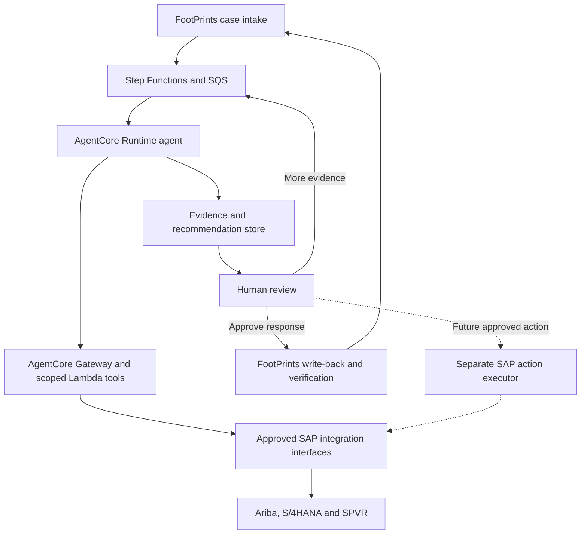

# AWS AgentCore–SAP integration for payment-mismatch investigation

Implementation decision report · 12 October 2026

**Evidence labels:** **Diagram fact** means explicitly shown in the supplied diagram, not verified as deployed. **Documented fact** means supported by official documentation. **Recommendation** means a proposed design. **Assumption** is a planning premise. **Needs validation** identifies an unresolved environment or interface detail. All proposed contracts and SAP touchpoints require validation against the actual tenant, edition, release, permissions, and API metadata.

## 1. Executive summary

**Recommendation:** Retain the diagram’s single investigation-and-resolution agent on AgentCore Runtime. Expose narrowly scoped business tools through AgentCore Gateway, backed by Lambda adapters. Have those adapters call established SAP integration services where available; otherwise use approved SAP APIs directly. Use asynchronous case orchestration around bounded synchronous reads. Introduce SAP events only for a demonstrated freshness or scale requirement.

**Diagram fact:** Phase 1 polls the FootPrints PO-mismatch queue, investigates using Ariba data, obtains human review, and writes approved results to FootPrints. It does **not** show S/4HANA or SPVR integration, an email connector, autonomous SAP correction, or an ITAR router. Its scope note explicitly excludes ticket classification and ITAR routing. The filename does not override this scope note. [D]

**Documented fact:** Gateway can expose APIs and Lambda functions as MCP-compatible tools. A Lambda target can implement its business function and return JSON; it need not run its own MCP server. This matches the existing Lambda tool design. [1][2]

**Assumptions:** FootPrints remains the case system; SAP systems remain authoritative for their business records; the team has access to nonproduction SAP environments. Existing SAP Integration Suite availability is **Needs validation**, not assumed.

**Immediate decision:** Authorize a read-only vertical slice first: FootPrints ticket → PO/invoice/receipt evidence → deterministic mismatch checks → reviewer-approved FootPrints comment. Add S/4HANA financial status and SPVR supplier identity after their owners validate the interfaces. SAP writes require a separately approved scope and execution path.

## 2. Current-state interpretation

**Diagram facts—not deployment verification:** [D]

| Stage | What the diagram shows |
|---|---|
| Intake | EventBridge Scheduler invokes a FootPrints polling Lambda; checkpointing and deduplication identify new/changed tickets; normalization builds case context; an intake Step Functions workflow coordinates processing. |
| Attachments | Extraction Lambda retrieves attachments; S3 holds landing, clean, and quarantine objects; a result handler receives scan outcomes; invoice-scope determination normalizes PO-based invoices. The scanning engine itself is not identified. |
| Validation | Identifier validation checks PO, invoice, supplier, and line references. Missing information produces a clarification comment for human approval. An investigation Step Functions workflow coordinates the case. |
| Investigation | One PO Mismatch Investigation & Resolution Agent runs in AgentCore Runtime. Identity, Policy, Memory, Observability, and Gateway appear as supporting services. |
| Tools | PR ITAR Context, PO Context, Invoice Context, IR Exceptions, Receipt Context, Mismatch Rules, and Resolution Map are Lambda-based tools. |
| Human review | A reviewer approves, edits, overrides, or requests further investigation. FootPrints Write-Back Service and Write-Back Result Validator update and verify the ticket. |
| Persistence and failures | Aurora PostgreSQL holds case, evidence, agent/tool, approval, and write-back history. Retry handling, SQS dead-letter and manual-review queues support exceptions. Enterprise systems shown are FootPrints, SAP Ariba APIs, and Amazon S3. |

**Needs validation:** The “PR ITAR Context” tool reads an ITAR indicator, while the scope note excludes ITAR routing. An indicator retrieved during investigation is not an intake control. Confirm where data is classified and rejected or routed **before** attachment processing and model invocation. The diagram also labels SQS-based handoffs without fully defining the consumer/dispatcher implementation; that wiring must be explicit.

The requested payment investigation scope is broader than the diagram’s PO-mismatch scope. S/4HANA payment evidence, SPVR lookup, email intake, and optional SAP updates are **proposed extensions**, not current-state findings.

## 3. Recommended AgentCore–SAP integration pattern

**Documented capabilities:** AgentCore Gateway supports Lambda and OpenAPI targets; SAP Cloud Integration has OData, SOAP/HTTP, RFC, and IDoc integration capabilities. SAP S/4HANA can publish supported business events through SAP eventing infrastructure. These capabilities do not establish that any particular interface is enabled in your landscape. [1][3][4][5][6]

**Recommendation and trade-offs:**

| Option | Appropriate use | Trade-off and decision |
|---|---|---|
| Direct API | Gateway → Lambda business tool → approved SAP HTTPS API; alternatively a curated OpenAPI target when authentication, schema, and networking fit. | Fewer hops and quickest initial build. AWS team owns SAP mapping, pagination, auth, throttling, and release changes. Use for a small, stable, approved API set when no reusable middleware exists. |
| Middleware-mediated | Gateway → Lambda business tool → enterprise API / SAP Integration Suite → SAP. API Management can apply enterprise API policies; integration flows handle mapping and adapters. | Adds a hop and another operational owner, but centralizes SAP credentials, protocol handling, and reusable mappings. Preferred for existing governed SAP integration services and legacy interfaces. Do not add middleware solely to relay unchanged JSON. |
| Event-driven | Supported SAP event → approved bridge/integration flow → AWS queue/workflow → targeted reread. | Decouples change notification and supports asynchronous processing. Adds subscription, replay, ordering, and reconciliation work. Events supplement authoritative reads; event coverage, payload, and bridge need validation. Defer unless polling or on-demand reads cannot meet requirements. |

**Selected pattern:** A stable business-tool layer with a conditional backend: reuse existing SAP middleware; otherwise implement approved direct APIs behind the same tools. Gateway provides the agent-facing interface; the adapter/middleware provides SAP integration semantics. Do not expose unrestricted OData queries, arbitrary URLs, generic RFC execution, or database access to the model.

| Decision factor | Implementation implication |
|---|---|
| Security | Separate agent, Gateway, adapter, and SAP identities; restrict tools to specific business reads. |
| Latency | Parallelize independent reads within SAP limits; fetch only needed fields. Measure middleware overhead and SAP response time; no latency SLA can be inferred from the diagram. |
| Reliability | Normalize errors, limit concurrency, and make retries and case replay explicit. Middleware does not by itself guarantee successful business processing. |
| Freshness | Return retrieval time and source-update time; refresh critical records before approval/action. Treat replicated/reporting data as potentially delayed. |
| Coupling | Keep SAP-specific fields and release changes inside adapters; expose versioned business contracts. |
| Auditability | Preserve source keys, request IDs, snapshots, rule versions, reviewer identity, and action outcomes. |
| Development effort | Reuse existing APIs/integration flows; establish one working read path before building all tools. |
| Production operations | AWS owns case execution and adapters; SAP integration/Basis owners own backend availability, permissions, and transports. Agree on shared incident escalation. |

**Protocol boundaries:** OData/REST suits selective reads. SOAP is relevant where the required released interface is SOAP-only. RFC/BAPI is a legacy/private-system option behind a supported adapter; availability in S/4HANA Public Edition must not be presumed. SAP’s RFC receiver documents sRFC and transactional function-module execution, with runtime-specific restrictions. IDoc is appropriate for existing asynchronous document exchange, not an interactive lookup substitute; SAP Cloud Integration’s IDoc adapter exchanges IDocs via SOAP web services. [3][4][5]

## 4. Target architecture and data flow

**Proposed architecture.** S/4HANA and SPVR are extensions; middleware is conditional. SAP writes remain disabled in Phase 1.

**Recommended sequence:**

1. **Intake:** Poll FootPrints with an overlap window and durable ticket/version deduplication. If email intake is later approved, create/associate a case and retain its message ID; no email connector is shown today.
2. **Admission and validation:** Enforce approved data-classification controls before extraction or LLM processing. Validate ticket identifiers; request clarification instead of inventing missing invoice or PO keys. Ticket-type classification is unnecessary when the existing queue already determines scope.
3. **Investigation dispatch:** Persist the case and enqueue a reference. A defined consumer starts/invokes the investigation workflow and agent; do not assume Runtime automatically subscribes to SQS.
4. **Evidence collection:** The agent calls typed tools. Adapters authorize business scope, query SAP, handle pagination, normalize data, and persist timestamped evidence. For long Ariba reports, return a job/pending result and resume through workflow polling rather than hold an agent call open.
5. **Mismatch analysis:** Rules compare ordered, received, and invoiced quantities; prices, currency, tax/freight, tolerances, credits/reversals, and supplier/PO references. The agent explains rule outcomes and evidence gaps. Business owners must define the actual tolerances and precedence rules.
6. **Recommendation and review:** Produce an evidence-linked proposed action, owner, rationale, and response draft. Persist the approval state outside the agent session. Step Functions supports callback-based human review; use a Standard workflow with an authenticated approval service. [7]
7. **Optional SAP action:** In a later phase, a separate executor validates approval, exact payload, source version, action allowlist, and idempotency before invoking a validated write API. Re-read the outcome. A transport-level success alone does not establish business completion.
8. **Response and closure:** Finalize the response from verified outcomes; obtain renewed approval for material changes. Write the approved comment/status to FootPrints, verify it, and close only when business closure criteria are met. Email sending is a separate, unconfirmed integration.

## 5. Integration points and draft data contracts

**All rows below are proposed touchpoints.** API names are documented candidates, not confirmed tenant endpoints. “Read-only” describes the permissions recommended for this solution, even when an underlying API also offers write operations.

| Component / tool | Required evidence and system | Candidate API or adapter | Mode and authority |
|---|---|---|---|
| Intake, attachments, clarification | FootPrints ticket, revision, attachments, requester and existing references | Actual FootPrints ticket/attachment API: **Needs validation** | Scheduled/asynchronous intake; read. Human approval for clarification write-back. |
| PO Context | Ariba PO/lines; S/4HANA PO if authoritative: quantities, prices, currency, supplier, organizational keys | Ariba Operational Reporting API for Procurement; S/4 candidate `API_PURCHASEORDER_PROCESS_SRV`, or applicable Purchase Order V4 API [8][9][10] | Bounded synchronous reads; asynchronous reporting when needed. No per-read human approval within authorized scope. |
| Invoice Context | Ariba invoice and PO references; S/4 posted supplier invoice and fiscal year | Ariba reporting; S/4 candidate `API_SUPPLIERINVOICE_PROCESS_SRV` [8][11] | Read-only, synchronous where supported; asynchronous extraction otherwise. |
| IR Exceptions | Ariba invoice-reconciliation state and available exception evidence | Ariba reporting view for Invoice Reconciliation; exact exception/detail fields **Needs validation** [8] | Read-only; reporting mode depends on endpoint. Do not assume status alone includes exception reasons. |
| Receipt Context | Ariba receipts; S/4 goods movements, reversals and PO-item linkage; service acceptance when applicable | Ariba reporting; S/4 candidate `API_MATERIAL_DOCUMENT_SRV`; service-entry-sheet interface **Needs validation** [8][12] | Read-only; on-demand reads or asynchronous reports. Service procurement requires separate acceptance evidence. |
| Supplier Context — new | SPVR supplier record, cross-system IDs, permitted status attributes; S/4 business partner/supplier | SPVR owner-approved API/view/feed **Needs validation**; S/4 candidate `API_BUSINESS_PARTNER` [13] | Read-only; sync API or timestamped feed. Do not infer SPVR is an SAP product or has a standard SAP API. |
| Payment Status — new | S/4 accounting document, open/cleared items, payment block and relevant payment/remittance evidence | Candidate Operational Journal Entry Item read API `API_OPLACCTGDOCITEMCUBE_SRV`; supplementary payment/bank-status API **Needs validation** [14][15] | Read-only, scoped synchronous query where supported. Finance must validate interpretation and field coverage. |
| PR ITAR Context | Requisition/PO linkage and authoritative classification indicator | Existing Ariba/custom field or classification service **Needs validation** | Read-only context. Cannot substitute for pre-ingestion admission control. |
| Mismatch Rules / Resolution Map | Retrieved evidence, tolerances, action owners, approved response templates | Versioned application rules and configuration; no SAP call inherently required | Deterministic local computation. Recommendations require reviewer approval before external write-back. |
| Investigation / summary / root-cause functions | Evidence returned by the above tools | Same scoped tools; no direct SAP credentials | One agent in the diagram. Separate summary or root-cause agents are not shown and are not necessary for Phase 1. |
| Approved write-back | FootPrints comment/status now; exact SAP business action only in future scope | FootPrints API **Needs validation**; future released SAP API chosen by action | Write-capable executor, human approval, post-write verification. Supplier-bank changes, payment release, posting, and reversal stay outside Phase 1. |

**Documented fact:** Ariba procurement reporting covers purchase orders, receipts, invoices, and invoice reconciliations and supports synchronous and asynchronous usage. Its documentation specifies extraction restrictions. Validate actual rate limits, filters, view fields, pagination, and freshness before selecting it for interactive investigation. Do not substitute an Ariba Business Network or sourcing API for a procurement API without confirming the licensed product and data ownership. [8][16]

**Recommendation:** Define a source-of-truth map by entity and field. Preserve Ariba and ERP identifiers separately. Do not equate “invoice reconciled,” “invoice posted,” “accounting item cleared,” “payment instruction sent,” and “supplier received funds.” The candidate accounting API is a starting point, not proof of end-to-end settlement. Missing evidence should produce `unknown` or `partial`, not “unpaid.” [14][15]

**Proposed contract—not a representation of SAP’s native schema:**

| Contract area | Proposed fields / rules |
|---|---|
| Common request | `schemaVersion`, `caseId`, `correlationId`, `toolInvocationId`, `operation`, `sourceSystem`, `sourceTenant`, `businessScope`, `identifiers`, `asOfRequirement`. Derive authorization scope from trusted identity/case records, not model-supplied claims. |
| Business keys | FootPrints ticket ID + revision; Ariba realm + document ID/version; S/4 system/client + company code where applicable; PO + item; supplier invoice + fiscal year; accounting document + company code + fiscal year; material document + year + item; SPVR supplier ID and governed crosswalk. Exact native composite keys: **Needs validation**. |
| Correlation | Business `caseId` stays stable across attempts; `correlationId` links a workflow execution; separate trace/span, runtime session, tool-call, SAP request, middleware message, event/job and approval IDs. Do not use an agent session ID as the sole audit key. |
| Success / partial response | `status: complete|partial|pending|not_found`, `data`, `sourceReferences`, `retrievedAt`, `sourceUpdatedAt` when available, `sourceVersion`/`etag` when available, `warnings`, `nextPageToken` or `jobId`. Missing source timestamps remain unknown. |
| Error | `error.code`, safe `message`, `retryable`, `upstreamStatus`, `upstreamRequestId`, optional `retryAfter`, and per-source errors for partial results. Proposed codes: `VALIDATION`, `UNAUTHORIZED`, `FORBIDDEN`, `NOT_FOUND`, `THROTTLED`, `TIMEOUT`, `UPSTREAM_UNAVAILABLE`, `CONFLICT`, `BUSINESS_REJECTED`. |
| Formats | UTF-8 JSON for business tools; adapters translate OData JSON/XML, SOAP XML or IDoc formats as required. ISO-8601 UTC timestamps; identifiers as strings preserving leading zeros; decimal monetary values with currency; quantities with unit; attachments by protected object reference and content hash. |
| Idempotency | Intake key = source + ticket + revision. Future action key = case + action type + target key + approved payload hash/version. Store outcome durably; reconcile ambiguous timeouts before repeating a write. Native SAP idempotency support: **Needs validation**. |
| Versioning / approval | Version tool schema, mappings, rules and prompts independently. Use ETag/`If-Match` only where supported. Approval binds approver, target, payload hash, evidence versions, permitted action and expiry; stale evidence or changed payload requires re-review. |

## 6. Security and governance

**Documented facts:** Gateway separates inbound and outbound authorization; supported outbound mechanisms depend on target type. Lambda targets use the Gateway service role. Policy can authorize individual Gateway tool invocations. Ariba APIs use API-gateway and OAuth controls; SAP-side authentication must match the particular communication scenario or adapter. IAM authorization to a Lambda does not authorize that Lambda inside SAP. [17][18][19][20]

**Recommended controls:**

- **Least privilege at each hop:** Runtime role invokes only the intended Gateway; Gateway role invokes only approved tool functions; adapters access only required secrets and destinations. SAP read credentials have restricted business scope. Separate deployment roles from runtime roles and read identities from future write identities.
- **Tool authorization:** Allowlist tools and validate company code, supplier/case scope, identifiers, field selection and row limits server-side. Treat tickets, attachments and SAP text as untrusted content. The model cannot grant itself permissions or assert that approval occurred.
- **SAP identity:** Use dedicated noninteractive technical/communication identities per environment and function. Select OAuth, certificate/mTLS, or another explicitly supported mechanism with SAP owners. Do not assume every S/4HANA API accepts OAuth client credentials. If an interface requires mTLS or specialized session handling, terminate it in the capable adapter/middleware; Gateway OAuth support does not prove native SAP mTLS compatibility. [17][20]
- **Credential lifecycle:** Keep adapter credentials/private keys in an approved secret store, such as Secrets Manager for AWS adapters or the SAP integration credential store for SAP flows. Use AgentCore credential providers where Gateway itself authenticates outward. Rotate at both issuer and consumer, test renewal and revocation, and alert before certificate expiry. Secrets Manager does not automatically rotate arbitrary SAP credentials without an implemented rotation process. [17][21]
- **Networking:** A VPC-enabled Lambda can reach private SAP interfaces through approved routing, DNS, firewalls, and VPN/Direct Connect. A private OpenAPI/MCP Gateway target is another documented option; validate its target-specific requirements. SAP Cloud Connector supports relevant SAP BTP connectivity patterns—it is not a general AWS network tunnel. Ariba SaaS may require controlled outbound HTTPS; do not label the entire path private without verification. [2][3][22]
- **Approval enforcement:** Keep approval in an authenticated service and durable state. The executor verifies authorization and source freshness immediately before any consequential action; deny expired, mismatched, or replayed approvals.
- **Sensitive data / ITAR:** Establish data eligibility before models, extraction, memory, or telemetry receive content. Minimize supplier personal and financial data; avoid bank details in prompts/logs. Set retention, encryption, restricted support access and audit controls across evidence, backups and observability. AWS describes support for ITAR compliance, but the diagram does not establish workload compliance. Approved region/partition, specific AgentCore/model availability, inference routing, personnel access and contractual controls are **Needs validation** by security/export-control owners. No claim is made that GovCloud is universally required or that every AgentCore capability is available there. [23]

## 7. Local development, cloud development, and deployment model

**Documented fact:** The current AgentCore CLI supports local development and cloud deployment; code ZIP and container build paths are documented. Runtime versions are immutable, while the `DEFAULT` endpoint moves on update. A named endpoint can reference a selected version. Pin the team’s tooling version rather than mixing commands from older and current toolkits. [24][25]

**Recommended environment model:**

| Environment | Develop / verify here | Data and connectivity |
|---|---|---|
| Local | Agent logic, prompts, extraction on synthetic files, typed tools, normalization, mismatch rules, response schemas, mocked approvals and contract tests. Run the agent locally; mock model calls for offline tests. | Mock SAP/FootPrints HTTP services and synthetic fixtures. Calling Bedrock or managed Gateway from a laptop still uses cloud services and credentials. |
| Cloud development | Actual Runtime, Gateway/Policy, IAM, networking, Lambda, Step Functions, SQS, S3 and Aurora integration. A remote development host is useful when private access is unavailable locally. | AWS dev account and SAP development/sandbox endpoints; restricted nonproduction identities. |
| Test | Contract compatibility, negative authorization, pagination, throttling, partial results, timeouts, duplicate delivery, stale evidence, approval replay and load. | Isolated integration environment with resettable seeded SAP cases; representative transport/configuration. |
| UAT | Business validation of evidence, rules, recommendations, reviewer workflow and closure criteria; operational rehearsal. | Business-approved masked/test data and SAP QA/UAT system. |
| Production | Promote tested artifacts, monitor and support; no interactive development changes. | Production SAP identities, explicit network rules, approved retention and access. |

Local mocks cannot prove SAP permissions, tenant-specific fields, native business validation, private connectivity, or managed-service behavior. Verify these remotely against the actual nonproduction endpoints. Prefer separate production and nonproduction AWS accounts; map each to explicit SAP systems/clients/realms. Endpoint names alone are not environment isolation.

**Mocking approach:** Obtain approved OpenAPI specifications, OData `$metadata`, WSDLs, report view schemas and redacted samples from SAP owners. Build WireMock/MockServer or lightweight HTTP stubs around the adapter boundary. Include missing receipts, multiple POs per invoice, partial deliveries, reversals/credits, service invoices, cross-company duplicates, currency/unit differences, and a timed-out write with an unknown outcome. Record expected business decisions with business owners; do not derive every test expectation from the implementation.

**Repository and infrastructure:** Keep agent code, tool adapters, contracts, rules, evaluation fixtures, workflow definitions, IaC and environment configuration in source control. Use one approved IaC approach such as CDK/CloudFormation or Terraform; validate resource support for the selected versions. SAP integration flows, communication setup and SAP transports need coordinated SAP-owned promotion. Store secret references, never credentials, in configuration.

**CI/CD:** Pull request → lint/unit/contract tests → dependency/image and IaC checks → build immutable artifact → deploy dev/test → authenticated SAP integration tests and agent evaluations → UAT/business sign-off → controlled production promotion → smoke checks and monitoring. Promote the same artifact digest with environment-specific configuration. Test both business accuracy and denied/unsafe tool-call behavior.

**Deployment and rollback:** Choose ZIP for simple supported dependencies or containers for controlled native dependencies, and follow the Runtime packaging requirements. Pin production to a named Runtime endpoint/version; do not depend on `DEFAULT`. Retain the previous agent artifact plus compatible Lambda, contracts, rules and workflows. Roll back traffic/configuration together; use backward-compatible database migrations. Rolling back code does not reverse SAP postings or FootPrints comments. [24][25]

## 8. Reliability and operations

**Documented facts:** AgentCore Observability provides CloudWatch-backed metrics and OpenTelemetry-compatible telemetry. SQS can redeliver messages, so a successful first execution does not remove the need for idempotency. [26][27]

**Minimum recommended operating model:**

| Concern | Required implementation |
|---|---|
| Traceability | Propagate case/correlation IDs through workflow, agent, tools and integration layer; retain SAP/middleware request IDs. Instrument adapter spans explicitly. Redact payloads and credentials. |
| Metrics | Per-tool/SAP p50/p95 latency, timeout/error/throttle rate, queue age, report-job age, evidence age, retry and DLQ count, approval backlog, model tokens/cost, failed writes, and business reviewer rejection rate. Set thresholds after measuring representative load. |
| Timeouts and retries | Explicit connect/read and overall tool deadlines within the workflow budget. Bounded exponential backoff with jitter for transient failures; honor `Retry-After`. Refresh expired auth once where appropriate; do not repeatedly retry authorization, validation or business-rule failures. Avoid multiplied retries across layers. |
| Load protection | Limit concurrency per SAP tenant/API, bound pagination and response size, cache only with an explicit freshness policy, and stop repeated calls during backend outages. |
| Partial evidence | Preserve successful results but mark the investigation incomplete; identify unavailable sources. Block definitive payment/closure claims when required evidence is missing. |
| DLQ and replay | Persist original event/reference, attempt history, error class and failed stage. Alert an owner; replay only after cause correction, deduplication and approval/freshness checks. Do not let replay duplicate ticket comments or SAP actions. |
| Audit | Record evidence references/hashes, source versions, model/prompt/tool/rule versions, decision rationale, reviewer identity and edits, approved payload, executor identity, response and post-action verification. Application audit records are required in addition to service logs. |
| Incident response | Runbooks for SAP outage, token/certificate expiry, stale reports, bad mappings, unauthorized tool calls and ambiguous writes. Provide kill switches for new investigations and all writes while preserving evidence and manual handling. Test restore and agree RTO/RPO. |
| Ownership | Application owner: case correctness and agent/tool behavior. AWS platform: runtime, network and observability. SAP/integration owners: APIs, mappings, authorization and transports. Business operations: approvals and manual queue. Security: access incidents and data handling. Name primary/backup owners and escalation targets before go-live. |

For future writes, exactly-once business effect must be designed across the application and SAP boundary; neither a queue setting nor retry policy alone establishes it. Resolve an unknown commit outcome with a status/read-back check before any retry.

## 9. Open questions, risks, and decisions

**All items require stakeholder confirmation.**

| Owner | Question / decision | Risk if unresolved |
|---|---|---|
| Business / architecture | Is Phase 1 PO mismatch only, or broader payment investigation? Is FootPrints the sole intake/closure channel? Which actions are allowed? | Unplanned email/SAP-write scope and misleading closure. |
| SAP / Finance | Which S/4 edition, release, systems/clients and company codes? Which APIs are released, activated and authorized? Who defines paid/cleared/blocked/settled? | Correct API name but unusable interface or incorrect payment answer. |
| Ariba owner | Which product/realm, procurement APIs, report fields, exception details, rate limits, and freshness guarantees? | Reporting data mistaken for live operational truth. |
| Supplier-data owner | What is SPVR, who owns it, which interface exists, and how do supplier IDs map across systems? | Incorrect supplier matching or unsupported integration assumptions. |
| Integration team | Existing Integration Suite/API Management, approved enterprise APIs, Cloud Connector, event broker and support ownership? | Duplicate infrastructure, missing adapters or unclear outage ownership. |
| Security / export control | Where is classification enforced before extraction/inference? Which data, services, regions, model routes, operators and support paths are approved? | Sensitive or controlled content enters an unapproved processing path. |
| AWS / network | Selected account/partition/region, service and model availability, quotas, private routes, DNS, egress, certificates and deployment roles? | Locally working code fails in cloud or violates network policy. |
| QA / business | Representative seeded cases, expected outcomes, numerical tolerances, acceptance thresholds and evidence freshness limits? | Attractive summaries without validated investigation accuracy. |
| Operations | Case volume, peak concurrency, time-to-investigate target, SAP maintenance windows, retention, RTO/RPO, on-call ownership? | Backlogs, unexpected cost and unrecoverable cases. |
| SAP / business, future phase | Exact write operation, approval authority, supported API, concurrency/idempotency semantics and compensation procedure? | Duplicate, stale or unauthorized business changes. |

## 10. Recommended next steps

1. **Freeze the scope:** Approve the read-only SAP / human-approved FootPrints Phase 1 boundary and identify the pre-ingestion classification control.
2. **Run one interface workshop:** SAP, Ariba, SPVR, integration and AWS owners produce an endpoint/owner inventory, entity source-of-truth map, authentication matrix and sample nonproduction payloads. Replace each “Needs validation” with evidence or an explicit gap.
3. **Prove connectivity without an agent:** In AWS dev, use a scoped adapter to retrieve one PO, invoice and receipt, then a supplier and financial-status record if available. Record latency, permissions, pagination, source timestamps and cross-system keys.
4. **Implement one complete case:** Connect FootPrints intake, durable workflow, Gateway tools, deterministic mismatch rules, evidence storage, authenticated review and verified write-back. Demonstrate missing-data and backend-failure paths.
5. **Gate production on evidence:** Business UAT acceptance, denied-write tests, duplicate/replay tests, classification/access validation, rollback/restore rehearsal, monitoring and named support ownership.
6. **Expand only from measured need:** Add further business objects and optional events; evaluate SAP writes as a separate controlled increment after a specific action and supported API have been validated.

### Sources

Official documentation was checked for capabilities; no live AWS account, SAP tenant, middleware configuration, or API was accessed. Some SAP documentation is release-specific. Candidate interface selection therefore remains subject to actual-system validation.

- **[D]** Supplied `fps-itar-router-updated-container-diagram.png`, titled “FootPrints PO Mismatch Resolution Platform — C4 Container Diagram,” including its scope note.
- **[1]** AWS: [AgentCore Gateway](https://docs.aws.amazon.com/bedrock-agentcore/latest/devguide/gateway.html).
- **[2]** AWS: [Private connectivity patterns for AgentCore Gateway targets](https://aws.amazon.com/blogs/networking-and-content-delivery/private-connectivity-patterns-for-amazon-bedrock-agentcore-gateway-targets/).
- **[3]** SAP: [RFC receiver adapter](https://help.sap.com/docs/integration-suite/sap-integration-suite/rfc-receiver-adapter).
- **[4]** SAP: [Setting up outbound HTTP connections](https://help.sap.com/docs/CLOUD_INTEGRATION/sap-cloud-integration/setting-up-outbound-http-connections).
- **[5]** SAP: [IDoc adapter](https://help.sap.com/docs/cloud-integration/sap-cloud-integration/idoc-adapter?locale=en-GB).
- **[6]** SAP: [Business events on SAP Business Accelerator Hub](https://help.sap.com/docs/SAP_S4HANA_ON-PREMISE/8308e6d301d54584a33cd04a9861bc52/8cbf952e55364254be2da77aa1342aa5.html).
- **[7]** AWS: [Workflow waiting for human approval](https://docs.aws.amazon.com/step-functions/latest/dg/tutorial-human-approval.html).
- **[8]** SAP: [Operational Reporting API for Procurement](https://help.sap.com/docs/ariba-apis/operational-reporting-api-for-procurement/operational-reporting-api-for-procurement).
- **[9]** SAP: [Read purchase order with schedule line and subcontracting component](https://help.sap.com/docs/SAP_S4HANA_CLOUD/bb9f1469daf04bd894ab2167f8132a1a/4bf51821d3434ce7975de25c6fd8643b.html).
- **[10]** SAP: [Operations for Purchase Orders, V4 paths](https://help.sap.com/docs/SAP_S4HANA_CLOUD/bb9f1469daf04bd894ab2167f8132a1a/649d14483a984b788f3753ac88b37810.html).
- **[11]** SAP: [Read complete invoice data with purchase order](https://help.sap.com/docs/PRODUCT_ID/bb9f1469daf04bd894ab2167f8132a1a/af62388a0c05492b94410ea79cb1b13f.html?locale=en-US&state=PRODUCTION&version=LATEST).
- **[12]** SAP: [Operations for Material Document API](https://help.sap.com/docs/SAP_S4HANA_CLOUD/3f57e7df4a114edabffe8b2d581a59ed/1aef4e402acd4c8b8ec2ea2bfda7715b.html).
- **[13]** SAP: [Business Partner (A2X) OData API](https://help.sap.com/docs/SAP_S4HANA_CLOUD/3c916ef10fc240c9afc594b346ffaf77/85043858ea0f9244e10000000a4450e5.html).
- **[14]** SAP: [APIs for General Ledger Accounting](https://help.sap.com/docs/SAP_S4HANA_CLOUD/0fa84c9d9c634132b7c4abb9ffdd8f06/54eaa306f7014d179cc540aab92faa92.html).
- **[15]** SAP: [Operational Journal Entry Item](https://help.sap.com/docs/SAP_S4HANA_CLOUD/b978f98fc5884ff2aeb10c8fdeb8a43b/efabeff3bf8b4066ac03f0965d0a9327.html).
- **[16]** SAP: [Operational Reporting API workflow](https://help.sap.com/docs/ariba-apis/operational-reporting-api-for-procurement/workflow-for-operational-reporting-api).
- **[17]** AWS: [Gateway outbound authorization](https://docs.aws.amazon.com/bedrock-agentcore/latest/devguide/gateway-outbound-auth.html).
- **[18]** AWS: [AgentCore Policy core concepts](https://docs.aws.amazon.com/bedrock-agentcore/latest/devguide/policy-core-concepts.html).
- **[19]** SAP: [API Gateway and OAuth authentication for Ariba](https://help.sap.com/docs/ARIBA_APIS/b61dd8c7e22c4fe489f191f66b4c48d6/99ef1f190ff647df8cffd681264c24d0.html).
- **[20]** SAP: [Communication arrangement example using OAuth](https://help.sap.com/docs/SUPPORT_CONTENT/fioritech/5156225199.html); authentication must be validated per scenario, not generalized from this example.
- **[21]** AWS: [Secrets Manager documentation](https://docs.aws.amazon.com/secretsmanager/).
- **[22]** AWS: [Gateway VPC egress and target-specific connectivity](https://docs.aws.amazon.com/bedrock-agentcore/latest/devguide/gateway-vpc-egress.html).
- **[23]** AWS: [ITAR compliance support](https://aws.amazon.com/compliance/itar/) and [GovCloud ITAR responsibilities](https://docs.aws.amazon.com/govcloud-us/latest/UserGuide/govcloud-itar.html).
- **[24]** AWS: [AgentCore CLI local development and deployment](https://docs.aws.amazon.com/bedrock-agentcore/latest/devguide/runtime-get-started-cli.html).
- **[25]** AWS: [Runtime versioning and endpoints](https://docs.aws.amazon.com/bedrock-agentcore/latest/devguide/agent-runtime-versioning.html).
- **[26]** AWS: [AgentCore Observability](https://docs.aws.amazon.com/bedrock-agentcore/latest/devguide/observability.html).
- **[27]** AWS: [SQS visibility timeout and redelivery](https://docs.aws.amazon.com/AWSSimpleQueueService/latest/SQSDeveloperGuide/sqs-visibility-timeout.html).
